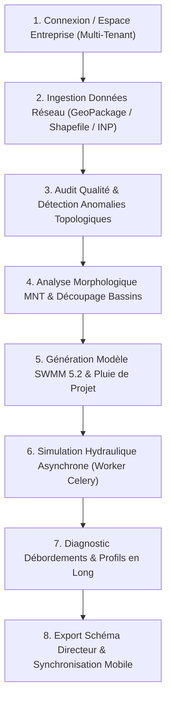

# Fiche Produit & Cadrage Stratégique — SWMM Platform SaaS

> **Plateforme Collaborative de Gestion Dynamique, Diagnostic de Qualité et Modélisation Hydraulique des Réseaux d'Assainissement & Eaux Pluviales**  
> **Version** : 1.0 (Phase 0 — Cadrage SaaS)  
> **Date** : Octobre 2026  
> **Statut** : Document de référence validé  

---

## 1. Vision et Proposition de Valeur

### 1.1 Constat Métier
L'exploitation, la gestion patrimoniale et la modélisation hydraulique des réseaux d'assainissement (eaux usées, eaux pluviales et réseaux unitaires) se heurtent aujourd'hui à des ruptures opérationnelles majeures :
- **Des données SIG hétérogènes et polluées** : Les bases géospatiales contiennent fréquemment des inversions de pente (contre-pentes), des nœuds orphelins, des doublons de regards, des diamètres non renseignés et des cotes de radier manquantes, rendant toute modélisation impossible sans semaines de nettoyage manuel.
- **Le cloisonnement entre bureau d'études et agents de terrain** : Les relevés d'inspection télévisée (ITV), les campagnes de curage et les constats de terrain restent consignés dans des bordereaux papier ou des fichiers isolés, sans réconciliation dynamique avec le modèle hydraulique.
- **La complexité des outils de modélisation (SWMM desktop / SIG lourds)** : Le moteur de référence mondial **EPA SWMM 5.2** nécessite une expertise pointue pour construire manuellement les fichiers `.inp`, délimiter les bassins versants et paramétrer les pluies de projet.
- **La vulnérabilité accrue aux inondations urbaines** : Face à l'imperméabilisation croissante et aux épisodes pluvieux intenses, les collectivités manquent d'un outil prédictif rapide pour localiser les goulots d'étranglement, dimensionner les bassins de rétention et évaluer l'impact des débordements en surface.

### 1.2 Notre Mission
**SWMM Platform SaaS** unifie l'analyse géospatiale, le contrôle qualité de données, la simulation hydraulique d'assainissement et la collecte mobile terrain dans une plateforme cloud collaborative unique :
> *"Permettre à chaque gestionnaire, régie communale et bureau d'études d'assainissement d'auditer la qualité de ses réseaux, de modéliser les écoulements de temps sec et de temps de pluie via le moteur certifié EPA SWMM 5.2, et de synchroniser en temps réel les données de terrain, directement dans le navigateur et sur smartphone."*

---

## 2. Personas Cibles

| Persona | Profil & Contexte | Pain Points principaux | Ce que SWMM Platform lui apporte |
|---|---|---|---|
| **1. Ingénieur Exploitation & Régie Assainissement** | Régie publique municipale, opérateur délégataire (SIAAP, SUEZ, VEOLIA, SEAAL, ONA). | Débordements de regards récurrents, plaintes riverains, obstructions, déversements non contrôlés en milieu naturel. | Cartographie interactive instantanée, détection des tronçons en surpression hydraulique, historique d'incidents, priorisation des curages. |
| **2. Chef de Projet Bureau d'Études Hydraulique** | Société d'ingénierie conseil, schéma directeur d'assainissement (SDA), zonage pluvial. | Préparation fastidieuse des fichiers `.inp`, vérification manuelle de milliers de cotes de radier, calage chronophage des bassins versants. | Générateur automatique de fichiers SWMM 5.2 depuis GeoPackage/PostGIS, détection automatique des anomalies géométriques, découpage MNT automatique. |
| **3. Technicien & Agent d'Exploitation Terrain** | Équipe mobile d'intervention, relevés topographiques, contrôles de conformité branchements. | Relevés papier perdus, formulaires non géolocalisés, déconnexion avec la base de données centrale SIG. | Application mobile Flutter connectée/déconnectée, mise à jour des attributs au pied du regard, capture photo des anomalies, guidage topologique. |
| **4. Directeur des Services Techniques / Élu** | Collectivité locale, établissement public de coopération intercommunale (EPCI). | Manque de visibilité patrimoniale, arbitrages budgétaires complexes pour le renouvellement des collecteurs. | Tableaux de bord synthétiques de santé du réseau (scoring de qualité 0-100), indicateurs de risque inondation, rapports d'audit prêts pour comités. |

---

## 3. Parcours Utilisateurs Clés (Core User Journeys)

### Parcours 1 : Diagnostic Qualité Express d'un Réseau SIG
1. L'ingénieur se connecte à son espace d'organisation cloisonné (`org_id`).
2. Il dépose son fichier d'infrastructure (ex: GeoPackage d'une commune de 10 000 regards et 10 000 canalisations).
3. Le système exécute en quelques secondes les règles de contrôle qualité :
   - Détection des conduites à contre-pente ou pente nulle.
   - Identification des regards doublons (< 2 m) et des nœuds borgnes sans exutoire.
   - Vérification des connexions amont-aval (tolérance géométrique 50 cm).
4. Un score global de santé du réseau (0 à 100) et la liste des anomalies géolocalisées apparaissent sur la carte interactive avec filtres par sévérité.

### Parcours 2 : Modélisation Pluviale & Prévention des Inondations
1. À partir du réseau assaini et validé, l'utilisateur charge le Modèle Numérique de Terrain (MNT raster).
2. L'algorithme délimite automatiquement les sous-bassins versants topographiques et associe chaque surface aux regards d'injection correspondants.
3. L'ingénieur choisit une pluie de projet (période de retour 2, 5, 10 ou 50 ans, intensité-durée-fréquence IDF).
4. Le compilateur SWMM génère le modèle complet (`.inp`) et lance la simulation en tâche de fond sur le cluster de calcul Celery.
5. L'utilisateur visualise en dynamique :
   - Les conduites saturées en charge ($Q/Q_{max} > 1$).
   - Les regards qui débordent en surface (inondation urbaine).
   - Les hydrogrammes de débit aux exutoires et stations de relevage.

### Parcours 3 : Campagne Terrain & Mise à Jour Mobile Déconnectée
1. Le technicien part sur le terrain avec sa tablette ou son smartphone Android équipé de l'application mobile Flutter.
2. L'application synchronise la zone d'intervention en cache local pour un fonctionnement **100% hors-ligne**.
3. Sur place, l'opérateur valide la cote réelle du tampon, corrige le sens de la canalisation ou signale un regard encombré avec photo à l'appui.
4. Dès retour d'une connexion 4G/Wi-Fi, les modifications sont poussées vers le serveur SaaS.
5. Le moteur de synchronisation résout les conflits, journalise les modifications dans l'audit trail et met à jour instantanément la base centrale.

### Parcours 4 : Édition du Rapport de Schéma Directeur & Restitution
1. L'utilisateur sélectionne un bassin versant ou l'ensemble de la commune.
2. Il génère le profil en long hydraulique des collecteurs principaux montrant le terrain naturel, le radier et la ligne de charge piézométrique.
3. Il télécharge le rapport d'expertise officiel au format PDF haute fidélité (métriques, cartographies, planches d'anomalies, tableau des investissements prioritaires).
4. Il exporte les jeux de données corrigés au format GeoPackage standard et `.inp` officiel certifié.

---

## 4. Différenciateurs Stratégiques

1. **Rigueur Scientifique Intégrale (Non-régression SWMM)** :
   Le cœur de calcul physique repose sur le moteur officiel **EPA SWMM 5.2** via `pyswmm` et le C-Toolkit standard. Les équations de Saint-Venant (onde dynamique, onde cinématique), les pertes de charge singulières et les formules de Manning-Strickler sont appliquées sans aucune approximation logicielle.
2. **Double Échelle Bureau-Terrain Native** :
   La plateforme supprime la barrière entre le bureau d'études modélisateur et l'agent d'exploitation sur le terrain grâce à une synchronisation bidirectionnelle mobile sécurisée avec traçabilité complète.
3. **Intelligence Topologique Hybride (Vecteur + MNT Raster)** :
   Contrairement aux outils SIG classiques qui demandent des manipulations fastidieuses, SWMM Platform croise automatiquement la géométrie du réseau sous-terrain avec le relief de surface (DEM/MNT) pour identifier les anomalies d'altitude et calculer les bassins réels.
4. **Architecture SaaS Multi-Tenant Industrielle** :
   Cloisonnement strict par organisation (`tenant_id`), architecture 12-factor, API unifiée haute performance (FastAPI), moteur de calcul asynchrone (Celery/Redis) et stockage objet découplé (S3/MinIO).
5. **Souveraineté et Portabilité Totale** :
   Stack 100% libre et déployable sur site (On-Premise) ou en Cloud souverain européen/national via Docker Compose sans aucune dépendance propriétaire coûteuse (zéro licence Esri ArcGIS ou InfoWorks requise).
