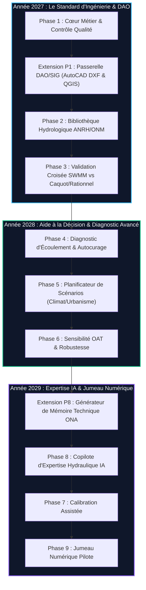

# ================================================================================
# Projet : DrainPilot 5.2 - Plateforme d'Assainissement Urbain & Calcul SWMM
# Auteur : Dr Abdelhakim KELLOUCHE
# Date de création : 2026-11-08
# Date de révision : 2026-11-08
# Objet : Feuille de route stratégique et technique pluriannuelle 2027 - 2029
# ================================================================================

# DrainPilot — Feuille de Route Stratégique & Technique (2027 – 2029)

> [!CAUTION]
> ### 🛑 RÈGLE D'OR DE DÉVELOPPEMENT : STRICTEMENT INTERDIT / NE PAS FAIRE AVANT 2027
> **L'année 2026 est exclusivement dédiée à la consolidation du socle existant** (stabilité du moteur PySWMM 5.2, sectorisation infaillible en bassins versants d'exutoires, intégrité du cache de calcul, et validation du MVP).  
> **Aucun développement des chantiers 2027–2029 ne doit être anticipé avant le 1er janvier 2027.** Toute tentative d'implémenter prématurément ces fonctionnalités en 2026 est proscrite pour éviter toute dispersion des ressources et garantir la robustesse absolue du code de production.

---

## 1. Vision et Piliers Stratégiques

### Vision Produit
Faire de **DrainPilot** la plateforme SaaS de référence en modélisation hydrodynamique et ingénierie d'assainissement dans l'espace francophone, combinant la puissance industrielle du solveur **EPA SWMM 5.2**, l'adaptation rigoureuse aux réalités hydrologiques locales (Algérie, Afrique du Nord, normes ONA/ANRH) et l'aide à la décision automatisée.

### Les Quatre Piliers Fondateurs
```
                  ┌──────────────────────────────────────────────┐
                  │          DRAINPILOT (2027 - 2029)            │
                  └──────────────────────┬───────────────────────┘
                                         │
     ┌───────────────────┬───────────────┴───────────────┬───────────────────┐
     ▼                   ▼                               ▼                   ▼
┌───────────────┐ ┌───────────────┐             ┌─────────────────┐ ┌─────────────────┐
│  Fiabilité    │ │   Richesse    │             │     Aide à      │ │    Clarté de    │
│  Technique    │ │ Hydrologique  │             │   la Décision   │ │   Restitution   │
│ (Solid Core)  │ │   (Territoire)│             │ (Scénarios & QA)│ │  (DAO & Rapports│
└───────────────┘ └───────────────┘             └─────────────────┘ └─────────────────┘
```

---

## 2. Programme Détaillé des Phases (2027 – 2029)



---

### Phase 1 : Consolidation du Cœur Métier & Passerelle DAO/SIG
> **Priorité absolue — Cible : Q1–Q2 2027**  
> **Objectif** : Faire de DrainPilot un environnement de calcul certifié où les bureaux d'études et collectivités peuvent modéliser en toute confiance.

#### 1.1 Contrôle Qualité Automatisé du Modèle
- **Détection des anomalies topologiques** : Nœuds orphelins, tronçons déconnectés, conduites en impasse.
- **Validation géométrique & altimétrique** : Détection des inversions de pente (pentes négatives), décalages brutaux de fil d'eau, sauts de diamètre non conformes (aval plus petit que l'amont hors ouvrages de régulation).
- **Complétude des données d'infrastructure** : Signalement systématique des cotes de radier manquantes, profondeur de regard nulle, cotes tampon erronées.
- **Règles métier de charge** : Contrôle des vitesses admissibles et vérification des contraintes de cisaillement.

#### 1.2 Éléments Hydrauliques Complexes
- **Ouvrages électromécaniques** : Modélisation fine des stations de pompage (pompes centrifuges, courbes caractéristiques $Q = f(H)$, lois de déclenchement par niveau flotteur).
- **Dispositifs anti-retour** : Clapets de battement, clapets à membrane contre les remontées de crue des oueds récepteurs.
- **Conduites étagées et profils spéciaux** : Canalisations ovoïdes, caniveaux trapézoïdaux, cadres béton doubles et triples.

#### 1.3 Ouvrages Spéciaux et Régulation
- **Déversoirs d'orage (DVO)** : Calcul dynamique des lois de déversement (seuil frontal, latéral, Poleni, seuil noyé).
- **Bassins d'orage & rétention** : Stockage temporaire avec loi hauteur-volume $V(h)$, orifice de fuite taré et surverse de secours.
- **Techniques alternatives (Eaux pluviales)** : Noues paysagères, tranchées d'infiltration, puits d'absorption avec loi d'exfiltration Darcy.

#### 1.4 [INTÉGRATION CLÉ 1] Passerelle DAO / SIG (AutoCAD DXF & QGIS)
- **Import direct AutoCAD (`.dxf` / `.dwg`)** : Parsing automatique des calques linéaires (canalisations) et ponctuels (regards, avaloirs, ouvrages).
- **Topologisation automatique à l'import** :
  - Fusion par tolérance spatiale réglable (snapping à 5 cm, 10 cm, 25 cm).
  - Détection automatique des nœuds d'intersection et cassure des lignes.
  - Reconstruction automatique du sens d'écoulement gravitaire basé sur l'altimétrie géomètre ou la pente du terrain.
- **Interpolation altimétrique par MNT** : En cas de cotes géomètre absentes dans le fichier DAO, projection automatique sur MNT haute résolution (Copernicus 30m / SRTM ou rasters locaux GeoTIFF importés) avec déduction des profondeurs d'enfouissement standard réglementaires.
- **Export SIG certifié** : Export direct du réseau corrigé et calculé en Shapefile, GeoPackage et DXF enrichi des attributs de calcul ($Q_{max}$, $V_{max}$, $H/D$, taux de charge).

> **Livrable** : *Module « DrainPilot Solid Core & CAD-Bridge »*

---

### Phase 2 : Bibliothèque Hydrologique Régionale
> **Forte valeur ajoutée — Cible : Q3 2027**  
> **Objectif** : Raccourcir le gradient entre la donnée météorologique brute et le modèle hydraulique prêt à tourner.

#### 2.1 Formules Analytiques et Réglementaires
- **Méthode Rationnelle classique et modifiée** : Formule rationnelle étendue avec temps de concentration ($t_c$) paramétrable selon Passini, Giandotti, Kirpich, Ventura.
- **Formule de Caquot (Circulaire 1977 adaptative)** : Paramétrage standard et calé sur les bassins urbains maghrébins.
- **Méthodes hydrologiques régionales** : Formules de Crupedix, Sogreah, Turazza adaptées aux bassins versants périurbains.

#### 2.2 Pluies de Projet et Hyétogrammes
- **Hyétogrammes synthétiques normalisés** :
  - Hyétogramme de **Chicago** (pluie d'orage centrée avec facteur de pointe $r$).
  - Hyétogramme du **Double Triangle (Méthode Desbordes)**.
  - Hyétogrammes **SCS (Soil Conservation Service)** : Types I, IA, II et III.
- **Périodes de retour réglementaires** : $T = 2\text{ ans}$, $T = 5\text{ ans}$, $T = 10\text{ ans}$ (décennale ONA), $T = 20\text{ ans}$, $T = 50\text{ ans}$, $T = 100\text{ ans}$ (centennale sécurité inondation).

#### 2.3 Référentiel Pluviométrique Maghreb & Francophone
- **Base ANRH / ONM intégrée** : Intégration certifiée des stations hydro-météorologiques par wilaya (Chlef, Alger, Oran, Constantine, etc.).
- **Coefficients de Montana $(a, b)$ certifiés** : Formule $I(t) = a \cdot t^{-b}$ directement injectée selon la station sélectionnée sans ressaisie manuelle.

> **Livrable** : *Module « Hydro-Générateur & Pluviométrie Territoriale »*

---

### Phase 3 : Validation Croisée des Résultats
> **Différenciation majeure — Cible : Q4 2027**  
> **Objectif** : Donner une crédibilité scientifique et contractuelle incontestable aux calculs présentés aux commissions techniques.

#### 3.1 Moteur Comparatif Multi-Modèles
- **Comparaison systématique à l'échelle du sous-bassin** :
  - Débit de pointe hydrodynamique dynamique : $Q_{SWMM}$ (DynWave)
  - Débit de pointe analytique de contrôle : $Q_{Rationnel}$ et $Q_{Caquot}$
  - Débit selon formules empiriques : $Q_{Sogreah}$
- **Indicateurs d'écart contractuel** :
  $$\Delta Q = \frac{Q_{SWMM} - Q_{Caquot}}{Q_{Caquot}} \times 100$$
- **Pastille de Conformité Hydraulique & Énergétique** :
  - Pastille Verte : Cohérence forte ($\Delta Q \le 15\%$, conservation des masses vérifiée).
  - Pastille Orange : Divergence modérée ($15\% < \Delta Q \le 30\%$, expliquée par l'effet capacitif du réseau).
  - Pastille Rouge : Anomalie majeure ($\Delta Q > 30\%$, suspecter une erreur de surface d'apport ou un stockage anormal).

> **Livrable** : *Module « Co-Pilote Validateur & Audit Multi-Modèles »*

---

### Phase 4 : Analyse Avancée & Diagnostic d'Écoulement
> **Aide à la décision opérationnelle — Cible : Q1–Q2 2028**  
> **Objectif** : Déceler en un coup d'œil les dysfonctionnements structurels et hydrauliques du réseau.

#### 4.1 Goulots d'Étranglement & Pertes de Charge
- **Détection des rétrécissements de section** : Identification automatique des singularités où la capacité amont dépasse la capacité aval.
- **Diagnostic des contre-pentes résiduelles** : Localisation des tronçons générant une mise en charge prématurée par perte d'énergie cinétique.
- **Étranglement par surcharge** : Quantification des volumes refoulés par manque de débouché à l'exutoire.

#### 4.2 Débordements & Inondations Urbaines
- **Comptabilité des nœuds inondés** :
  - Volume total débordé ($m^3$).
  - Débit instantané d'éjection en surface ($m^3/s$).
  - Durée de submersion du carrefour ou de la chaussée (heures, minutes).
- **Classification du risque voirie** : Risque piéton / circulation selon la hauteur de lame d'eau et la vitesse d'écoulement superficiel.

#### 4.3 Autocurage et Ensablement
- **Contrôle réglementaire des vitesses d'autocurage** :
  - Temps sec / Débit minimal : $V \ge 0.60\text{ m/s}$ (évite le dépôt des matières décantables).
  - Débit de pointe pleine section : $V \ge 1.00\text{ m/s}$ et $V \le 4.00\text{ m/s}$ (évite l'érosion du radier).
- **Cartographie thématique d'ensablement** : Visualisation rouge des tronçons stagnants exposés à l'envasement régulier.

> **Livrable** : *Tableau de Bord « Diagnostic d'Écoulement & Autocurage »*

---

### Phase 5 : Planificateur de Scénarios d'Aménagement
> **Planification urbaine et résilience — Cible : Q3 2028**  
> **Objectif** : Permettre aux urbanistes et ingénieurs de tester en quelques secondes l'impact de projets d'extension ou d'aménagements compensatoires.

#### 5.1 Stress-Tests d'Urbanisation & Imperméabilisation
- Simulation par paliers : $+10\%$, $+20\%$, $+30\%$ de surfaces imperméabilisées sur le bassin versant.
- Visualisation immédiate des nouvelles canalisations entrant en surcharge.

#### 5.2 Résilience au Changement Climatique
- Majoration des intensités de pluie : $+10\%$, $+15\%$, $+25\%$ sur $I_{max}$ ou pluies cinquantennales/centennales.
- Évaluation de la vulnérabilité des ouvrages existants face aux orages extrêmes méditerranéens.

#### 5.3 Dimensionnement Compensatoire
- Proposition automatique de surdimensionnement des conduites saturées.
- Calcul automatique du volume utile de bassin de rétention requis pour écrêter le débit de fuite au niveau toléré par l'exutoire.

> **Livrable** : *Module « Scenario Planner & Résilience Urbaine »*

---

### Phase 6 : Sensibilité et Incertitudes
> **Robustesse de modélisation — Cible : Q4 2028**  
> **Objectif** : Évaluer la stabilité des conclusions de l'étude face aux aléas de mesure des paramètres d'entrée.

#### 6.1 Analyse de Sensibilité One-At-A-Time (OAT)
- **Variation ciblée des paramètres hydrologiques** :
  - Coefficient d'imperméabilité ($\pm 10\%$).
  - Taux d'infiltration Horton (vitesse initiale $f_0$, vitesse finale $f_c$, constante de décrue $\alpha$).
  - Capacité de rétention superficielle (*Depression storage* $\pm 20\%$).
- **Variation des paramètres hydrauliques** :
  - Coefficient de rugosité de Manning-Strickler ($n \pm 15\%$).
  - Tolérance d'incertitude sur les pentes mesurées.

#### 6.2 Visualisation du Fuseau d'Incertitude
- Tracé de l'hydrogramme à l'exutoire sous forme de **bande de confiance à 90%** au lieu d'une courbe unitaire déterministe.

> **Livrable** : *Module « Analyse de Sensibilité & Fuseau d'Incertitude »*

---

### Phase 7 : Calibration Assistée (Recherche & Expertise Avancée)
> **Cible : Q1 2029 (Module Spécialisé)**  
> **Objectif** : Rapprocher le modèle numérique des enregistrements réels lorsque des chroniques in-situ sont disponibles.

#### 7.1 Métriques de Performance Normalisées
- Coefficient d'efficacité de **Nash-Sutcliffe (NSE)** :
  $$NSE = 1 - \frac{\sum (Q_{obs} - Q_{sim})^2}{\sum (Q_{obs} - \bar{Q}_{obs})^2}$$
- Erreur quadratique moyenne (**RMSE**) et coefficient de corrélation de Pearson ($R^2$).
- Bilan des volumes cumulés observés vs simulés.

#### 7.2 Moteur d'Optimisation Paramétrique
- Algorithmes d'optimisation locale bornée (Nelder-Mead, L-BFGS-B) pour ajuster automatiquement le coefficient de rugosité équivalent et les paramètres d'infiltration.
- Mode de calage supervisé avec bornes physiques infranchissables pour éviter tout sur-apprentissage non physique.

> **Livrable** : *Module « Calibration Assistant »*

---

### Phase 8 : Intelligence Artificielle Métier & Générateur de Rapports
> **Cible : Q2–Q3 2029**  
> **Objectif** : Démultiplier la productivité de l'ingénieur conseil et vulgariser l'expertise hydraulique.

#### 8.1 Copilote d'Expertise Hydraulique Déterministe
- **Explicabilité physique sans hallucination** : L'agent IA analyse le graphe topologique et le rapport de calcul SWMM pour fournir des explications claires :
  - *« Pourquoi le nœud R15 déborde-t-il à la 42ème minute ? »* $\rightarrow$ Explication causale : *« Le regard R15 reçoit un débit cumulé de 1.45 m³/s alors que la conduite aval C15 (Ø600, pente 0.2%) a une capacité maximale de 0.82 m³/s. »*
  - Recommandation technique immédiate de réhabilitation chiffrée.

#### 8.2 [INTÉGRATION CLÉ 2] Générateur de « Mémoire Technique d'Assainissement » (Word / PDF)
- **Génération automatique du dossier réglementaire certifié (normes ONA / DRE / Ministère)** :
  - **Fascicule 1 : Hypothèses générales et caractérisation du site** (localisation, géologie, occupation du sol, relief).
  - **Fascicule 2 : Étude hydrologique** (séries de pluies ANRH, paramètres Montana retenus, formules de temps de concentration, hyétogrammes tracés).
  - **Fascicule 3 : Dimensionnement & Modélisation SWMM** (inventaire des nœuds, conduites, profils en long hydrauliques, lignes d'eau maximales).
  - **Fascicule 4 : Diagnostic des surcharges & Note d'impact** (tableaux des regards sous pression, bilan d'autocurage, validation de continuité).
  - **Fascicule 5 : Planches graphiques haute définition** (cartes des charges en couleurs normalisées, schémas synoptiques des bassins).
- **Format éditable Word (`.docx`) et PDF certifié vectoriel** prêt pour signature et dépôt d'adjudication.

> **Livrable** : *Agent « Copilote Métier & Mémoire Technique Automatisé »*

---

### Phase 9 : Jumeau Numérique (Vision Long Terme 2029+)
> **Cible : Fin 2029 / 2030 (Démonstrateur Pilote)**  
> **Objectif** : Connecter le modèle de simulation hydraulique aux réseaux télémesurés pour la gestion prédictive en temps réel.

#### 9.1 Connexion aux Réseaux de Capteurs (IoT)
- Passerelle MQTT / API REST sécurisée pour acquérir les données des limnimètres radar, pluviomètres automatiques et sondes de niveau télétransmises (LoRaWAN / 4G).
- Intégration des prévisions météorologiques quantitatives de pluie (Nowcasting radar et modèles ECMWF / GFS).

#### 9.2 Alerte Précoce et Aide à l'Exploitation
- Simulation prédictive anticipée (calcul SWMM automatisé 3 heures avant l'impact de l'orage).
- Cartographie des carrefours à risque d'inondation en temps réel et notification automatique des équipes d'astreinte d'assainissement.

> **Livrable** : *Plateforme « DrainPilot Real-Time Twin »*

---

## 3. Ce qui est STRICTEMENT INTERDIT avant 2027

Pour garantir le succès industriel de DrainPilot, les règles de verrouillage suivantes s'appliquent jusqu'au 31 décembre 2026 :

| Périmètre | Statut 2026 | Date d'ouverture autorisée | Justification technique |
| :--- | :---: | :---: | :--- |
| **Passerelle d'import AutoCAD (.dxf/.dwg)** | 🚫 **Verrouillé** | Janvier 2027 | Priorité absolue à la stabilisation du format pivot GeoPackage (`.gpkg`). |
| **Bibliothèque d'hyétogrammes (Chicago, SCS)** | 🚫 **Verrouillé** | Juillet 2027 | Le modèle fonctionne actuellement avec les pluies décennales certifiées ANRH. |
| **Validation croisée Caquot / Rationnel** | 🚫 **Verrouillé** | Octobre 2027 | Le calcul dynamique SWMM doit d'abord être 100% stable sur les 122 bassins. |
| **Stress-tests climatiques & urbanisation** | 🚫 **Verrouillé** | Juillet 2028 | Nécessite un module d'édition d'attributs par lots complet. |
| **Algorithmes de calibration automatique** | 🚫 **Verrouillé** | Janvier 2029 | Risque de dispersion R&D sans chroniques de débits in-situ fiables. |
| **Générateur de rapports Word/PDF multipages** | 🚫 **Verrouillé** | Avril 2029 | L'export simple PDF et les tableaux de synthèse suffisent pour le POC/MVP. |
| **Connexion capteurs temps réel & IoT** | 🚫 **Verrouillé** | Fin 2029 | Dépend de l'instrumentation physique des régies d'eau et de l'ONA. |

---

## 4. Jalons Clés et Calendrier d'Exécution

```
2026 (EN COURS) : 
  └── Stabilisation, sectorisation, étanchéité du cache, PySWMM 5.2, validation POC
------------------------------------------------------------------------------------- (BARRIÈRE 2027)
2027 : 
  ├── Q1-Q2 : Phase 1 (Solid Core + Passerelle AutoCAD DXF / QGIS)
  ├── Q3    : Phase 2 (Bibliothèque Hydrologique ANRH + Chicago / SCS)
  └── Q4    : Phase 3 (Validation croisée SWMM vs Caquot / Rationnelle)

2028 : 
  ├── Q1-Q2 : Phase 4 (Diagnostic d'écoulement, autocurage, goulots)
  ├── Q3    : Phase 5 (Scénarios urbanisme, climat, dimensionnement rétention)
  └── Q4    : Phase 6 (Sensibilité OAT et fuseaux d'incertitude)

2029 : 
  ├── Q1    : Phase 7 (Calibration assistée sur données réelles)
  ├── Q2-Q3 : Phase 8 (Copilote IA explicable + Mémoire Technique Word/PDF certifié)
  └── Q4    : Phase 9 (Jumeau numérique pilote & télégestion)
```

---

## 5. Conclusion & Engagement Qualité

DrainPilot a vocation à s'imposer non pas comme un simple visualiseur de données cartographiques, mais comme le **système d'exploitation complet de l'ingénieur en assainissement**.

La stratégie retenue garantit :
1. **Zéro régression** grâce au respect strict de l'interdiction de tout développement anticipé avant 2027.
2. **Une transition fluide du bureau d'études au chantier**, avec l'intégration native de la passerelle DAO/AutoCAD et la génération automatique du dossier réglementaire ONA.
3. **Une supériorité technique et scientifique incontestable** face aux logiciels propriétaires fermés.

